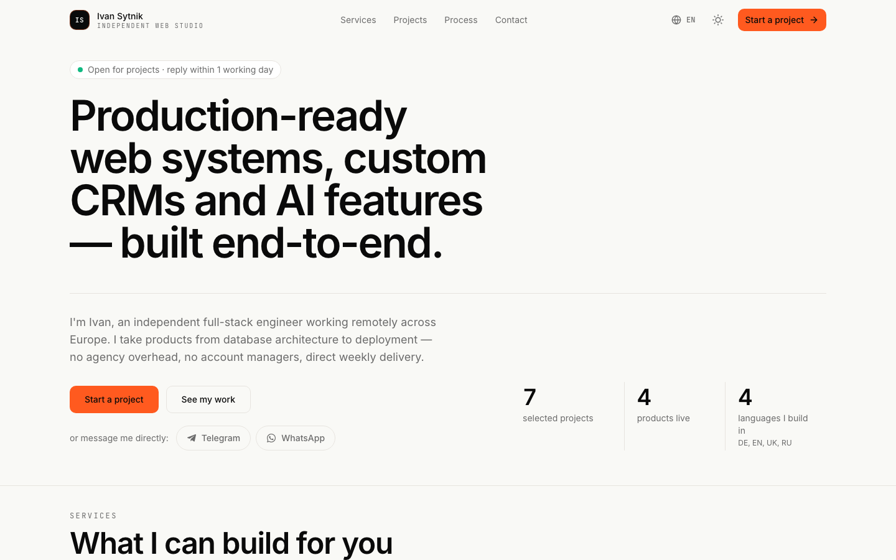
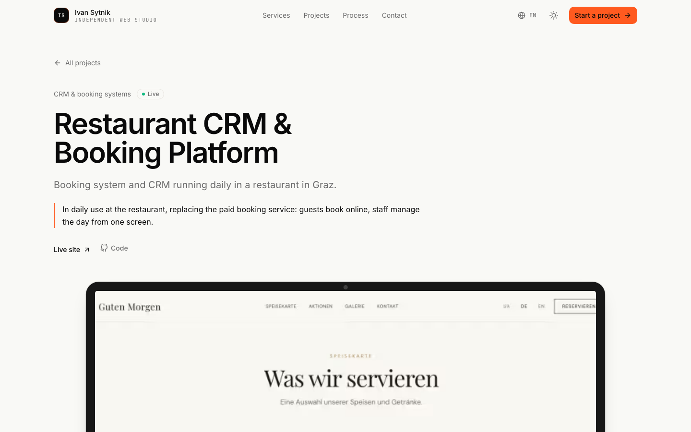
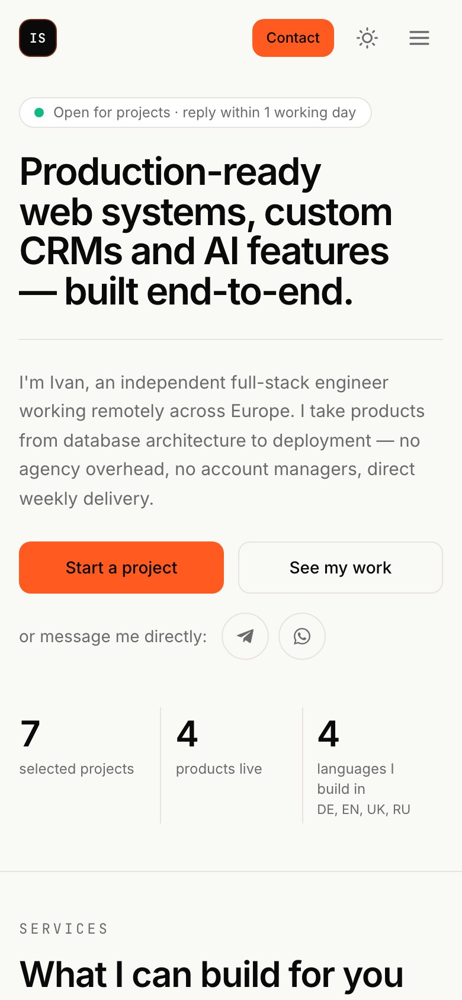

# Ivan Sytnik — Independent Web Studio

Portfolio and lead-generation site for Ivan Sytnik, a solo full-stack developer, presented as a small independent studio, in four languages.

[](https://github.com/IvanSytnik/sytnik-studio/actions/workflows/ci.yml)
[](LICENSE)
[](https://nextjs.org)
[](https://www.typescriptlang.org)
[](https://tailwindcss.com)
[](https://orm.drizzle.team)

**Live site:** <https://sytnik-studio.com>

## Screenshots

| Home (desktop) | Case study (desktop) |
| --- | --- |
|  |  |

<p align="center">
  
</p>

Captured with Playwright from a local production build (`npm run build && npm run start`), English locale, light theme.

## Contents

- [Overview](#overview)
- [Stack](#stack)
- [Setup](#setup)
- [Folder structure](#folder-structure)
- [Branding rules](#branding-rules)
- [Scripts](#scripts)
- [Deployment](#deployment)
- [Development log](#development-log)
- [License](#license)

## Overview

Portfolio & lead-generation site. Personal brand wrapped as a small independent studio.

It is aimed at prospective clients who need websites, booking systems and CRMs, or AI features, and want to hire one developer directly. The site shows selected work, explains services and process, and turns visitors into leads.

What it includes:

- **Landing page** with sections in this order: Hero → Services → Projects → Process → About → FAQ → Contact.
- **Case study pages** at `/projects/[slug]` for flagship projects, statically prerendered for every locale.
- **Four locales:** EN at `/`, DE at `/de`, UK at `/uk`, RU at `/ru`, with English fallback for untranslated keys.
- **Contact brief:** a three-step form built on a Server Action that works without JavaScript. Each lead goes to every configured channel (Neon Postgres, Resend email, Telegram). Spam protection uses a honeypot, a minimum fill time and a per-IP rate limit.
- **Light, dark and system themes**, plus a mobile navigation sheet and a sticky contact bar on mobile.
- **Legal pages:** `/impressum` and `/datenschutz`.
- **SEO:** per-locale metadata, canonical and hreflang links, Open Graph images generated at build time, JSON-LD, `robots.txt` and `sitemap.xml`. An indexing gate keeps the site `noindex` until it is explicitly enabled (see [Deployment](#deployment)).

## Stack

Next.js 15.5.26 · React 19.2.6 · TypeScript strict · Tailwind 3 · next-intl 4 · next-themes · Drizzle ORM + Neon Postgres · Resend · Vercel Analytics · Inter + JetBrains Mono · react-icons · framer-motion · react-hook-form + zod

Also used: Radix UI primitives (dialog, dropdown menu) for the UI kit, the Telegram Bot API for lead notifications, and ESLint 9 (flat config) with Prettier.

## Setup

Requirements: Node.js 22 LTS or newer (`engines` in `package.json`; CI runs Node 22) and npm.

```bash
npm install
cp .env.example .env.local
npm run dev
```

Open <http://localhost:3000>. EN at `/`, others at `/de`, `/uk`, `/ru`.

Every lead channel is optional. With an empty `.env.local` the site runs and the form renders, but no channel accepts submissions. To set up Neon, Resend and Telegram, see [`docs/CONTACT_SETUP.md`](docs/CONTACT_SETUP.md).

| Variable | Purpose |
| --- | --- |
| `NEXT_PUBLIC_SITE_URL` | Base URL for canonical links, the sitemap and Open Graph |
| `NEXT_PUBLIC_ALLOW_INDEXING` | `true` allows indexing; anything else makes the site `noindex` |
| `RESEND_API_KEY`, `RESEND_FROM_EMAIL`, `RESEND_TO_EMAIL` | Email delivery of leads via Resend |
| `TELEGRAM_BOT_TOKEN`, `TELEGRAM_CHAT_ID` | Telegram notifications for leads |
| `DATABASE_URL` | Neon Postgres connection; stores leads |
| `DATABASE_URL_UNPOOLED` | Optional. Direct connection used by `drizzle-kit` for schema changes |

## Folder structure

```
src/
  actions/
    contact.ts                 # Server Action for the contact brief
  app/
    [locale]/
      layout.tsx               # html, fonts, header + main + footer
      page.tsx                 # landing page: all sections in order
      not-found.tsx            # localized 404
      [...rest]/               # catch-all → localized 404
      projects/[slug]/         # case study pages + per-project OG image
      impressum/ datenschutz/  # legal notice, privacy policy
      opengraph-image.tsx      # per-locale OG image (next/og)
    globals.css                # design tokens
    icon.svg                   # IS monogram favicon
    robots.ts sitemap.ts       # indexing gate, hreflang sitemap
  assets/fonts/                # Inter (Cyrillic) for OG images, OFL
  components/
    layout/
      container.tsx            # max-width + gutters
      brand-mark.tsx           # logo: IS monogram + wordmark
      site-header.tsx          # sticky header
      site-footer.tsx          # footer (3 zones, hides empty social)
      mobile-nav.tsx           # hamburger + sheet
      theme-switcher.tsx
      language-switcher.tsx
    contact/                   # quick contact, section CTAs, mobile contact bar
    devices/                   # CSS laptop / phone frames for covers
    providers/theme-provider.tsx
    ui/                        # button, dropdown-menu, sheet
  features/                    # one folder per section
    hero/ services/ projects/ process/ about/ faq/ contact/ legal/
  lib/
    brand.ts                   # SSOT for identity
    nav.ts                     # nav items registry
    legal.ts                   # legal entity details, isLegalComplete
    server-env.ts              # Zod-validated lead channel config
    og/ seo/                   # OG renderer, JSON-LD
    env.ts utils.ts urls.ts deep-merge.ts
  db/
    schema.ts client.ts        # Drizzle + Neon
  i18n/
    routing.ts request.ts
  types/                       # next-intl typing, service ids, asset modules
  middleware.ts                # i18n locale routing
messages/
  en.json de.json uk.json ru.json
public/
  images/                      # portrait
  projects/<slug>/             # project covers and gallery (WebP)
scripts/
  check-contact.ts             # lead-channel health check
docs/                          # roadmap, status audit, contact setup, dev log, screenshots
```

## Branding rules

This is a **hybrid** product — solo developer wrapped as a studio. Never present as a multi-person team. Copy is first-person ("I"). Studio name is a brand wrapper only. Configured centrally in `src/lib/brand.ts`.

> **The brand is not licensed.** The names "Ivan Sytnik", "Sytnik Studio" and "Ivan Sytnik — Independent Web Studio", the `IS` monogram and logo (`src/app/icon.svg`, `brand-mark.tsx`), the portrait, project images and site copy are excluded from any permission. See [LICENSE](LICENSE).

## Scripts

| Script               | What it does                |
| -------------------- | --------------------------- |
| `npm run dev`        | Dev server                  |
| `npm run build`      | Production build            |
| `npm run start`      | Serve production build      |
| `npm run lint`       | ESLint (`--max-warnings 0`) |
| `npm run typecheck`  | `tsc --noEmit`              |
| `npm run format`     | Prettier write              |
| `npm run format:check` | Prettier check (no writes) |
| `npm run db:generate` | Generate SQL migrations into `drizzle/` |
| `npm run db:push`    | Push schema to Neon         |
| `npm run db:studio`  | Open Drizzle Studio         |

CI (`.github/workflows/ci.yml`) runs `typecheck`, `lint` and `build` on every push and pull request to `main`.

Lead-channel health check (not an npm script; `tsx` is not a dependency, so `npx` downloads it):

```bash
npx tsx scripts/check-contact.ts
```

It sends one real Telegram message and one real email, and inserts and then deletes one row in `contact_submissions`.

## Deployment

The production site, <https://sytnik-studio.com>, is hosted on Vercel.

1. Set the environment variables from the table in [Setup](#setup) under **Vercel → Project → Settings → Environment Variables** (Production + Preview), then redeploy. Set `NEXT_PUBLIC_SITE_URL` to the production domain; keep it in sync with `brand.url` in `src/lib/brand.ts`.
2. Database: create a Neon database from **Vercel → Storage**, which adds `DATABASE_URL`, then apply the schema with `npm run db:push`. Run `db:push` again after any change to `src/db/schema.ts`. Details: [`docs/CONTACT_SETUP.md`](docs/CONTACT_SETUP.md).
3. Indexing: set `NEXT_PUBLIC_ALLOW_INDEXING=true` **on Production only**, and only once `isLegalComplete` in `src/lib/legal.ts` is true. Previews and local builds stay `noindex`.

The middleware reads Vercel's `x-vercel-ip-country` header to send first-time visitors from Ukraine to `/uk`. This only works on Vercel.

## Development log

The pack-by-pack history ("Current state — Pack …") and the "Verifying Pack #2" checklist are in [`docs/DEVELOPMENT_LOG.md`](docs/DEVELOPMENT_LOG.md). The plan and audits are in [`docs/ROADMAP.md`](docs/ROADMAP.md) and [`docs/STATUS.md`](docs/STATUS.md).

## License

**View-only, all rights reserved.** You may read the code and fork it on GitHub to look at it. You may not reuse, redistribute or deploy it without written permission. The brand, logo, photos and content are not licensed for any use. See [LICENSE](LICENSE).
